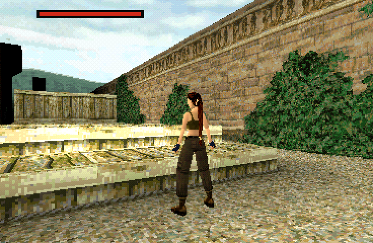
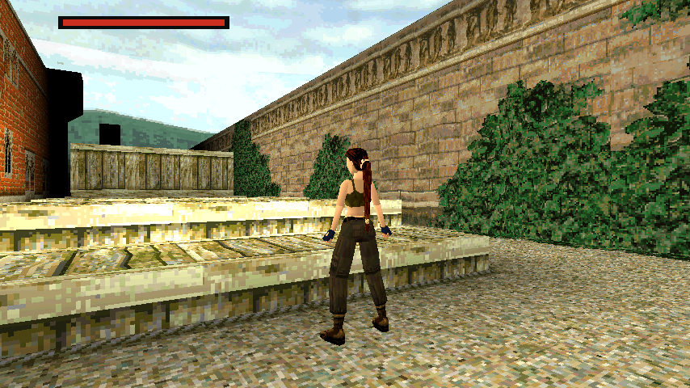
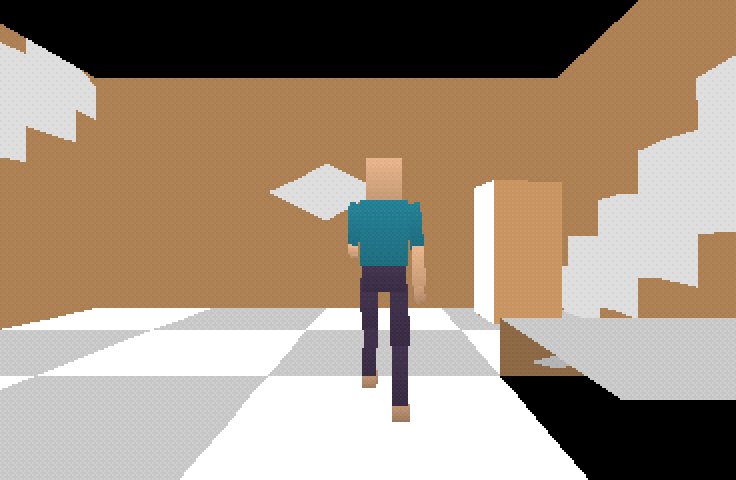

# Tomb Raider II, native Rust port

A native Rust port of Tomb Raider II (PlayStation, USA Rev 3), built with
[Bevy](https://bevyengine.org). It is not an emulator: the game is rewritten as
ordinary Bevy code on top of a separate, reusable engine, with a level editor
and support for mods.

| As on the PlayStation (368×240) | Widescreen, with the PS1 look off |
|---|---|
|  |  |

- **Engine, game and editor are separate.** `engine/` knows nothing about
  Tomb Raider; `game/` is Tomb Raider II on top of it; `editor/` edits the
  engine's level format and depends only on the engine.
- **Moddable.** A mod is a crate that builds on the game: it can add
  levels, object types and trigger actions, replace any of the game's, and
  swap out whole plugins. [`mods/example`](mods/example) is a small game made
  from hand-made assets, with its own level and character:

  
- **Modern options.** Widescreen and any resolution, an optional free camera
  with mouse look and analog stick ([docs](docs/free-camera.md)), and the PS1
  look (wobbling vertices, dither, 15-bit colour) can be switched off.

## Status: a work in progress

The game is not playable from start to finish yet. Every level loads and
draws from its own baked data, but much of what happens in them is still to
port. What is ported is checked tick for tick against recordings of the
original.

| Area | Status |
|---|---|
| Lara on land: walk, run, jump, grab, climb, ladders, shimmy, roll, slides | ✅ Ported; three played runs of the Home assault course match exactly |
| Wading and drowning | ✅ Ported |
| Swimming and water entry/exit | 🟡 Partly ported |
| Pistols | ✅ Ported |
| Shotgun, Uzis, harpoon, grenades, M16, flares | ❌ Not yet |
| Pickups, switches, keys, puzzle holes, doors, triggers | ✅ Ported |
| Inventory ring | ❌ Not yet |
| Lara's Home: assault course, Winston | ✅ Ported |
| The Great Wall: traps, zip-line, crows, tiger, spiders, T-Rexes | ✅ Ported |
| Venice: dogs, rats, gunmen, club men | ✅ Ported |
| Vehicles: motorboat, snowmobile | ❌ Not yet |
| Later levels' enemies and traps | ❌ Mostly not yet |
| Rendering: PS1 look, sky, underwater palette, caustics | ✅ Ported |
| Water surfaces, distance darkening | ❌ Not yet |
| Widescreen, free camera, PS1 look switches | ✅ Port additions |

The remaining work is tracked in [TODO.md](TODO.md), and the evidence for
each ported behaviour is indexed in [docs/evidence.md](docs/evidence.md).

## Built with psx

The port is made with [psx](https://github.com/bombpersons/psx), a
PlayStation reverse-engineering toolkit, which is what keeps it accurate:
- It extracts the disc's levels, models, textures, sounds and music into
  standalone files, so the port never reads the disc at run time.
- It runs the original in an emulator and records exactly what it does,
  tick by tick: any value in memory, every store to it and the code that
  wrote it. A person can play a level while it records (`psx handoff`).
- It disassembles and decompiles the original's code with Ghidra, so each
  rule in the port cites the routine it came from.
- It generated this project's Bevy template: the PS1 look, the tick rate
  and input, trajectory tests that compare the port with those recordings,
  and a developer MCP for driving and screenshotting the running port.

## Running it

This repository has no game data. Bake the levels, textures, sounds and music
from your own copy of the game (bin/cue) with psx on `PATH`, python3 with
Pillow, and Rust 1.97.1+:

```sh
tools/bake_assets.sh path/to/game.cue   # writes game/assets/ (gitignored)
cargo run                               # the game
cargo run -- --level wall               # start at the Great Wall
cargo run -p example-mod                # the example mod
cargo run -p editor                     # the level editor (docs/editor.md)
cargo test --workspace --all-features   # tests, including the recordings
```

F1 opens the controls menu and F2 the display menu. Without baked content,
the engine, editor, example mod and most tests still build and run.

## Layout

| Path | Contents |
|---|---|
| `engine/` | The reusable engine: object type and action registries, update order, level and tuning formats |
| `game/` | Tomb Raider II: per-type controllers, Lara, creatures, traps, HUD, menus, baked assets, trajectory tests |
| `editor/` | The level editor |
| `mods/example/` | An example mod |
| `psx-bevy/` | The psx template's crate: PS1 look, ticks, input, menus, testing, developer MCP ([README](psx-bevy/README.md)) |
| `tools/` | Asset importers, recording scripts and smoke tests |
| `docs/` | Evidence notes per feature, the engine model, Lara's asset contract |
